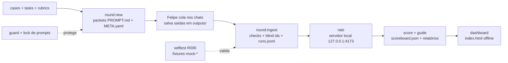

# Arquitetura — FJ-TestBoard v0.1

Node 20+, JavaScript ESM puro, zero build step. Dependências: `yaml` e `ajv`. Testes com `node:test` nativo.

## Pipeline

## Camadas

| Camada | Onde | Responsabilidade |
|---|---|---|
| Contratos | `schemas/*.schema.json` + `scripts/lib/validate.js` | Validação com ajv |
| Dados | `cases/`, `tasks/`, `rubrics/`, `private/answer-keys/` (local, não distribuído) | Casos fictícios, cartões de tarefa, rubricas, chaves de resposta |
| Checks | `scripts/checks/` | Biblioteca de checagens automáticas (hard/soft) |
| Harnês | `scripts/round-*.js`, `scripts/selftest.js` | Rodadas, packets, ingest, cegamento |
| Avaliação | `scripts/rate.js`, `scripts/score.js`, `scripts/guide.js` | Rating local e estatística |
| Saída | `reports/`, `dashboard/` | Relatórios pt-BR e painel offline |
| Proteção | `scripts/guard.js`, `tasks.lock.json` | Visibilidade `internal`; integridade de prompts |
